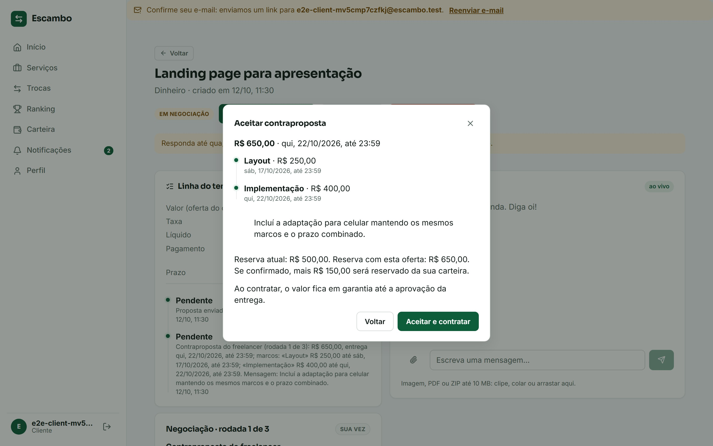
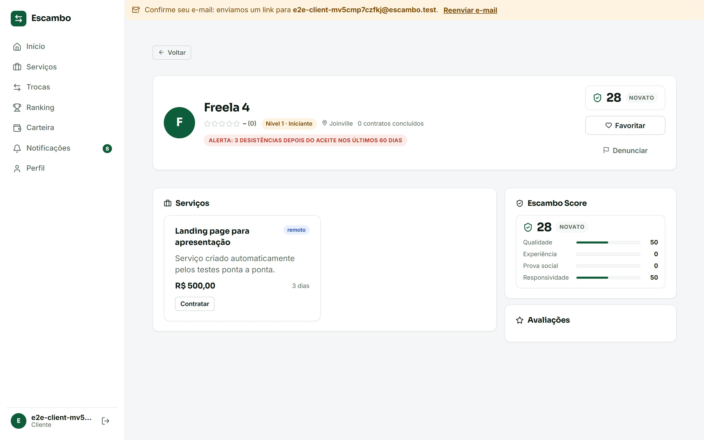
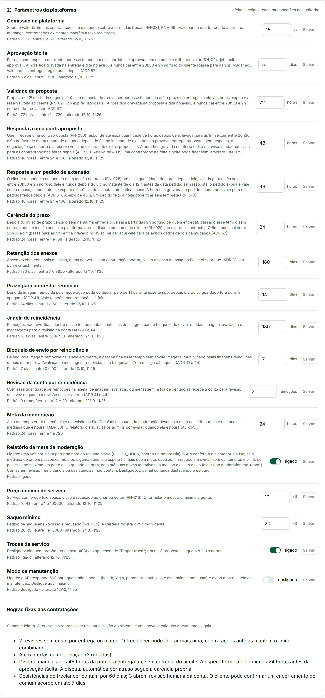
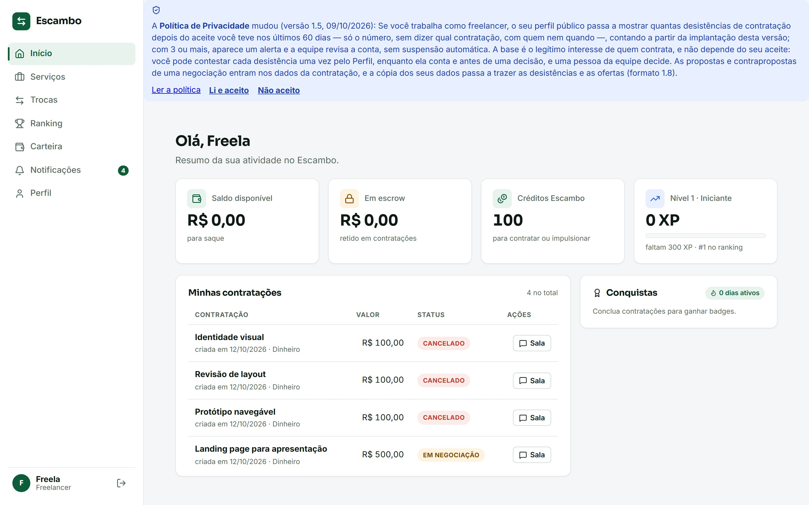

# Evidências de Validação — Escambo

> **Versão:** 1.1.0\
> **Disciplina:** PAC Extensionista VII — Católica SC\
> **Autor:** Guilherme Renzo
> **Data:** 2026\
> **Modalidade:** Projeto voltado à Comunidade (licença MIT)

---

## Índice

1. [Introdução](#1-introdução)
2. [Metodologia de Validação](#2-metodologia-de-validação)
3. [Perfil dos Entrevistados](#3-perfil-dos-entrevistados)
4. [Entrevistas com Freelancers](#4-entrevistas-com-freelancers)
5. [Entrevistas com Clientes](#5-entrevistas-com-clientes)
6. [Validação dos Wireframes com Usuários](#6-validação-dos-wireframes-com-usuários)
7. [Evidências de Comunidade](#7-evidências-de-comunidade)
8. [Síntese dos Resultados](#8-síntese-dos-resultados)
9. [Conclusão da Validação](#9-conclusão-da-validação)
10. [Próximos Passos](#10-próximos-passos)

---

## 1. Introdução

Esta seção documenta o processo de validação da demanda real pelo Escambo junto ao público-alvo identificado. Conforme as diretrizes do PAC Extensionista VII, projetos voltados à comunidade devem evidenciar a necessidade real da solução por meio de processo estruturado de validação — incluindo entrevistas com usuários, observação de campo e validação de protótipos.

A validação foi conduzida entre março e abril de 2026, com **trabalhadores autônomos e clientes de serviços** da região de Itajaí e Joinville (SC).

> **Impacto social identificado:** a pesquisa revelou que trabalhadores autônomos de baixa e média renda — especialmente os que oferecem serviços presenciais — são os mais prejudicados pela ausência de uma plataforma acessível, confiável e gratuita para se divulgar digitalmente.

---

## 2. Metodologia de Validação

A validação seguiu três etapas sequenciais:

| Etapa | Método                                   | Participantes | Período  |
| ----- | ---------------------------------------- | ------------- | -------- |
| 1     | Entrevistas qualitativas em profundidade | 5 freelancers | Mar/2026 |
| 2     | Entrevistas com clientes de serviços     | 3 clientes    | Mar/2026 |
| 3     | Teste de usabilidade dos wireframes      | 3 usuários    | Abr/2026 |

**Técnica de entrevista:** roteiro semiestruturado com perguntas abertas, sem apresentar a solução antes de mapear as dores. Cada entrevista durou entre 20 e 35 minutos, realizadas presencialmente ou via videochamada.

**Análise:** os relatos foram agrupados por tema usando a técnica de **Affinity Mapping** — identificando padrões de dor, comportamento e expectativa entre os participantes.

---

## 3. Perfil dos Entrevistados

### 3.1 Freelancers (5 entrevistados)

| #   | Profissão               | Cidade        | Idade | Usa plataforma? |
| --- | ----------------------- | ------------- | ----- | --------------- |
| F01 | Eletricista autônomo    | Itajaí, SC    | 42    | Não             |
| F02 | Desenvolvedor front-end | Joinville, SC | 27    | Sim (Workana)   |
| F03 | Diarista / faxineira    | Itajaí, SC    | 38    | Não             |
| F04 | Designer gráfico        | Blumenau, SC  | 31    | Sim (GetNinjas) |
| F05 | Técnico de informática  | Itajaí, SC    | 36    | Sim (GetNinjas) |

**Observação:** 3 dos 5 entrevistados (60%) não utilizam nenhuma plataforma digital para captar clientes — dependem exclusivamente de indicações.

---

### 3.2 Clientes (3 entrevistados)

| #   | Perfil               | Cidade       | Idade | Já usou plataforma?                |
| --- | -------------------- | ------------ | ----- | ---------------------------------- |
| C01 | Analista de RH (CLT) | Blumenau, SC | 34    | Sim (GetNinjas — experiência ruim) |
| C02 | Empreendedora / MEI  | Itajaí, SC   | 38    | Sim (Workana)                      |
| C03 | Gerente de loja      | Blumenau, SC | 40    | Sim (grupos de WhatsApp)           |

---

## 4. Entrevistas com Freelancers

### 4.1 Principais Dores Identificadas

As entrevistas revelaram **4 dores recorrentes** entre os freelancers:

---

#### Dor F-01 — Invisibilidade digital

> _"Meu serviço é bom, todo mundo que me chama volta. Mas como eu faço pra chegar em quem nunca me chamou?"_\
> — **F01, eletricista, 42 anos, Itajaí**

**Frequência:** 4 de 5 entrevistados relataram dificuldade de aquisição de novos clientes fora do círculo de indicações.

---

#### Dor F-02 — Custo de plataformas sem garantia de retorno

> _"Paguei R$ 60 em moedas no GetNinjas. Mandei proposta pra 8 clientes. Fechei zero. Nunca mais."_\
> — **F05, técnico de informática, 36 anos, Itajaí**

> _"A Workana me colocou numa fila de espera. Depois de meses pagando o plano, consegui 1 projeto. A comissão deles é absurda."_\
> — **F02, desenvolvedor, 27 anos, Joinville**

**Frequência:** 3 de 3 freelancers que já usaram plataformas relataram insatisfação com o modelo de monetização.

---

#### Dor F-03 — Ausência de ferramentas de gestão financeira

> _"Controlo tudo numa caderneta. Às vezes esqueço de cobrar, outras vezes cobro errado. Não sei direito quanto ganho por mês."_\
> — **F03, diarista, 38 anos, Itajaí**

**Frequência:** 4 de 5 entrevistados não possuem nenhuma ferramenta digital de controle financeiro.

---

#### Dor F-04 — Falta de reputação digital verificável

> _"Tenho fotos dos meus trabalhos no celular, mas não sei como mostrar isso de forma profissional pra quem não me conhece."_\
> — **F04, designer gráfico, 31 anos, Blumenau**

**Frequência:** 5 de 5 freelancers não possuem portfólio digital organizado e verificável.

---

### 4.2 O Que os Freelancers Querem

Pergunta feita ao final de cada entrevista: _"Se existisse uma plataforma ideal pra você, o que ela teria?"_

| Funcionalidade desejada                               | Mencionada por |
| ----------------------------------------------------- | -------------- |
| Aparecer para clientes próximos sem pagar por lead    | 5/5            |
| Ter um perfil profissional com portfólio e avaliações | 5/5            |
| Receber pagamento de forma segura pela plataforma     | 4/5            |
| Controlar ganhos e histórico financeiro               | 4/5            |
| Chat separado do WhatsApp pessoal                     | 3/5            |

---

## 5. Entrevistas com Clientes

### 5.1 Principais Dores Identificadas

---

#### Dor C-01 — Falta de confiança no profissional desconhecido

> _"Quando alguém indica eu contrato tranquilo. Mas quando não conheço, fico com medo de pagar e ser mal atendida."_\
> — **C01, analista de RH, 34 anos, Blumenau**

**Frequência:** 3 de 3 clientes citaram confiança como principal barreira para contratar freelancers desconhecidos.

---

#### Dor C-02 — Risco financeiro sem intermediação de pagamento

> _"Paguei metade adiantado pra um designer pelo GetNinjas. Ele sumiu depois de mandar uma primeira versão ruim. Não tinha como recuperar."_\
> — **C01, analista de RH, 34 anos, Blumenau**

**Frequência:** 2 de 3 clientes relataram insegurança no pagamento adiantado sem garantia.

---

#### Dor C-03 — Processo lento para encontrar profissionais

> _"Postei no grupo do WhatsApp pedindo um eletricista. Recebi vários contatos. Passei dois dias tentando agendar. Um não atendeu, outro sumiu."_\
> — **C03, gerente de loja, 40 anos, Blumenau**

> _"Queria algo rápido, tipo um iFood. Por que contratar serviço tem que ser tão complicado?"_\
> — **C01, analista de RH, 34 anos, Blumenau**

**Frequência:** 3 de 3 clientes relataram o processo de contratação como lento e burocrático.

---

### 5.2 O Que os Clientes Querem

| Funcionalidade desejada                    | Mencionada por |
| ------------------------------------------ | -------------- |
| Avaliações verificadas de outros clientes  | 3/3            |
| Encontrar profissional próximo rapidamente | 3/3            |
| Pagamento seguro com garantia de devolução | 2/3            |
| Ver portfólio de trabalhos anteriores      | 2/3            |
| Chat dentro da plataforma sem WhatsApp     | 2/3            |

---

## 6. Validação dos Wireframes com Usuários

### 6.1 Metodologia

Os wireframes das telas principais foram apresentados a **3 usuários** (2 freelancers + 1 cliente) para teste de usabilidade com protocolo **Think Aloud** — onde o usuário verbaliza o raciocínio enquanto interage com o protótipo.

**Tarefa testada — Cliente:** _"Encontre um eletricista perto de você e envie uma proposta de contratação."_

**Tarefa testada — Freelancer:** _"Verifique seus ganhos do mês e confira o progresso de XP."_

---

### 6.2 Resultados por Tela

| Tela                         | Usuários testados | Completaram sem ajuda | Pontos de confusão                                         |
| ---------------------------- | ----------------- | --------------------- | ---------------------------------------------------------- |
| WF-01 — Home/Busca           | 3                 | 3/3 (100%)            | Nenhum                                                     |
| WF-02 — Perfil do freelancer | 3                 | 3/3 (100%)            | 1 usuário não viu o botão de chat                          |
| WF-03 — Dashboard            | 2                 | 2/2 (100%)            | XP não era familiar para 1 freelancer                      |
| WF-04 — Chat                 | 3                 | 3/3 (100%)            | Nenhum                                                     |
| WF-05 — Pagamento            | 1                 | 1/1 (100%)            | Questionou o valor da taxa                                 |
| WF-06 — Conquistas           | 2                 | 1/2 (50%)             | 1 freelancer não entendeu o sistema de missões de imediato |

---

### 6.3 Feedbacks Qualitativos

> _"Ficou muito fácil de usar. Parece o iFood mesmo — procurei o serviço, vi o perfil, já quis contratar."_\
> — **C01, durante o teste do WF-01 e WF-02**

> _"O dashboard ficou bem claro. Sei exatamente quanto ganhei e quantos contratos tenho abertos."_\
> — **F02, durante o teste do WF-03**

> _"Esse negócio de XP e missão eu não entendia no começo. Mas depois que você explica faz sentido — é tipo um jogo."_\
> — **F05, durante o teste do WF-06**

---

### 6.4 Ajustes Identificados

| #   | Problema                                            | Solução proposta                                     |
| --- | --------------------------------------------------- | ---------------------------------------------------- |
| A01 | Botão de chat pouco visível no perfil               | Aumentar ícone e adicionar label "Mensagem"          |
| A02 | Sistema de missões não intuitivo no primeiro acesso | Adicionar tooltip explicativo na primeira vez        |
| A03 | Taxa de 15% gerou questionamento                    | Adicionar explicação inline sobre o que a taxa cobre |

---

## 7. Evidências de Comunidade

### 7.1 Grupos Analisados

Durante a pesquisa, foram observados **2 grupos locais** de troca de serviços:

| Grupo                      | Plataforma | Membros        | Observação                                                     |
| -------------------------- | ---------- | -------------- | -------------------------------------------------------------- |
| "Serviços Itajaí e Região" | WhatsApp   | ~320 membros   | 15–20 pedidos por dia; sem avaliações, sem preço padronizado   |
| "Freelancers SC"           | Facebook   | ~1.800 membros | Mistura de portfólio e pedidos; sem intermediação de pagamento |

**Padrões observados:**

- Clientes pedem recomendações antes de contratar alguém desconhecido
- Não há forma de verificar a reputação dos profissionais nesses grupos
- Relatos frequentes de problemas: calote, não comparecimento, qualidade abaixo do esperado

---

### 7.2 Dados de Mercado Corroborativos

| Dado                                                      | Fonte                    |
| --------------------------------------------------------- | ------------------------ |
| 25,5 milhões de trabalhadores por conta própria no Brasil | IBGE, PNAD Contínua 2024 |
| 74,3% dos autônomos sem CNPJ                              | IBGE, PNAD Contínua 2024 |
| Renda média do autônomo sem CNPJ: R$ 2.084/mês            | IBGE, 2025               |
| 86% de crescimento em pedidos no GetNinjas (2019–2020)    | Terra, 2021              |

---

## 8. Síntese dos Resultados

| Hipótese                                                   | Status        | Evidência                                            |
| ---------------------------------------------------------- | ------------- | ---------------------------------------------------- |
| Freelancers têm dificuldade de aquisição de novos clientes | ✅ Confirmada | 4/5 dependem exclusivamente de indicações            |
| Clientes desconfiam de freelancers desconhecidos           | ✅ Confirmada | 3/3 citaram confiança como barreira principal        |
| Modelo de compra de leads é rejeitado                      | ✅ Confirmada | 3/3 usuários de plataformas relataram insatisfação   |
| Pagamento seguro é prioritário para clientes               | ✅ Confirmada | 2/3 relataram insegurança no pagamento adiantado     |
| Interface simples é mais importante que funcionalidades    | ✅ Confirmada | 100% completaram as tarefas críticas sem ajuda       |
| Gamificação pode parecer complexa na primeira exposição    | ✅ Confirmada | 1/2 freelancers teve dificuldade inicial com missões |

---

## 9. Conclusão da Validação

A pesquisa confirmou todas as hipóteses centrais do projeto. Os dados coletados demonstram que:

1. **O problema é real** — afeta trabalhadores autônomos que dependem 100% de indicações e não possuem ferramentas digitais de divulgação ou gestão.
2. **As soluções existentes não resolvem** — os entrevistados que testaram GetNinjas e Workana relataram insatisfação com custos, interface e falta de garantias.
3. **A proposta do Escambo é validada** — as funcionalidades mais demandadas espontaneamente (perfil gratuito, pagamento seguro, avaliações verificadas, dashboard) coincidem exatamente com o escopo do MVP.
4. **A interface está adequada** — 100% dos usuários completaram as tarefas principais sem ajuda. Os 3 ajustes identificados são pontuais e não comprometem os fluxos críticos.

---

## 10. Próximos Passos

| #   | Ação                                                       | Prazo    |
| --- | ---------------------------------------------------------- | -------- |
| 1   | Implementar ajustes A01, A02 e A03 dos testes              | Mai/2026 |
| 2   | Criar protótipo navegável no Figma                         | Mai/2026 |
| 3   | Definir política final de comissionamento                  | Mai/2026 |
| 4   | Iniciar desenvolvimento — módulos de Autenticação e Perfis | Jun/2026 |

---

## 11. Validação técnica local do ADR 61 — 09/10/2026

Esta seção registra testes de implementação com contas fictícias e banco isolado; não acrescenta entrevistas nem validação com usuários reais às seções anteriores. O candidato 1.42.0 permanece local, sem deploy confirmado.

| Regra / garantia         | Suítes de integração MySQL 8 em apps/api/test/integration                 | Evidência                                                                                                                                                               |
| ------------------------ | ------------------------------------------------------------------------- | ----------------------------------------------------------------------------------------------------------------------------------------------------------------------- |
| Reserva e concorrência   | carteira-travas, carteira-pool, negociacao, cancelamento, marcos-centavos | Espera real no InnoDB, pool de uma conexão, corrida entre saída de pending e contraproposta, reserva compatível com a última oferta do cliente                          |
| Revisões e janela        | revisoes, disputa-janela, contratos-leitura-regras, adr61-reparo          | Duas por unidade, liberação extra, legado NULL/contador 256, contadores esperados, primeira evidência e snapshots conservados, datas UTC                                |
| Desistências e direitos  | desistencias, desistencias-direitos, lgpd-flow                            | Evento/reembolso atômicos, contagem inclusiva e confirmação em sete dias, contestação/decisão privadas, reconciliação após falha, anonimização com mutação/aviso em voo |
| Revisão de conta e saúde | content-moderation, moderation-health, moderation-sla-report, appeals     | Causas independentes, denúncia comum imitando prefixo, revisões fora da meta/automáticas e pendência de desistência somente de conta ativa                              |

Os nomes abreviados correspondem a arquivos *.int.test.ts. Unitários de API/web cobrem regras puras, schemas/rotas, mensagens, estados e timers das telas. Na validação consolidada **da etapa de desistências**, antes do painel/textos legais, passaram API 4.347, web 1.986 (mais 16 TODO preexistentes) e 73 integrações de dez arquivos; esses números são uma execução histórica, não o resultado final do candidato. Etapas anteriores também conferiram negociação, revisões, janela e recuperação com MySQL real.

No navegador interno, QA local confirmou negociação, liberação 2/2→2/3 e terceiro pedido, marcos independentes e legado ilimitado; terceira desistência abriu alerta/revisão, confirmação do cliente reduziu 3→2 e decisão humana reduziu 2→1, sem movimento financeiro posterior. Prints reais das contas fictícias:

### Painel, documentos legais e candidato 1.42.0

Validação local concluída em 09/10/2026, com contas fictícias e MySQL descartável, após integrar os parâmetros e os documentos legais. Resultados consolidados por suíte/arquivo:

| Verificação        | Resultado                                                                                                                                                                               |
| ------------------ | --------------------------------------------------------------------------------------------------------------------------------------------------------------------------------------- |
| Unitários API      | 193 arquivos, 4.362 testes aprovados                                                                                                                                                    |
| Unitários web      | 93 arquivos, 1.991 testes aprovados e 16 TODO preexistentes; 30 testes legais também conferidos após os ajustes finais de redação                                                       |
| Integração MySQL 8 | Dez arquivos, 103 testes aprovados: platform-settings, legal-rules, desistencias-direitos, lgpd-flow, negociacao, revisoes, disputa-janela, adr61-reparo, cancelamento e deadlines-flow |
| Qualidade          | Lint, typecheck dos três workspaces, TypeScript adicional de seis arquivos de integração, build e formatação/diff dos arquivos alterados aprovados                                      |
| API compilada      | Execução de dist/server.js contra o banco isolado: health 1.42.0, parâmetros públicos e alteração auditada pelo painel funcionando                                                      |
| Banco              | 60 tabelas de aplicação, 34 migrations incluindo baseline, servidor UTC e detector de reserva do cliente sem divergências nas fixtures                                                  |

Os parâmetros de resposta à contraproposta e à extensão aceitam 24–168 h, com padrão 48. Testes alteraram os valores para 96/72 h e depois 24 h: novas contagens acompanharam a configuração, enquanto snapshots anteriores permaneceram iguais. Valores inválidos escritos diretamente no banco usam o padrão 48 em painel, consulta pública e nova contagem. As sete regras fixas expostas no painel não possuem campos nem botão de edição.

Na QA do navegador interno, a Política 1.5 apareceu antes dos Termos. A recusa foi registrada; os Termos informativos apareceram em seguida e foram registrados. Após recarregar, ambas as faixas continuaram encerradas. A contagem pública permaneceu em três, com alerta, sem revelar contratação, cliente, data ou justificativa. A contestação privada continuou disponível. Outra integração conferiu cadastro nas versões 1.5, reconhecimento histórico da 1.4 e recusa de versão futura desconhecida.

O painel exibiu 17 parâmetros editáveis. Alterações de contraproposta para 72 h e de extensão para 96 h registraram o administrador; ambos foram restaurados a 48 h. A alteração final foi atendida pela API compilada. A anonimização também foi conferida nas decisões excused e upheld: remove a justificativa da desistência e sua cópia em admin_actions.description, preserva ação/autor/alvo/data e mantém intacta a nota de outra conta ativa.

O build conserva o aviso de bundle web acima de 500 kB. Na etapa de 09/10, a suíte E2E de política vigente foi atualizada e conferida pelo TypeScript, sem execução automatizada válida dos cenários Playwright. A QA acima foi realizada no navegador interno. A execução automatizada posterior está registrada abaixo.

### E2E e revisão final do candidato — 12/10/2026

Rodada completa contra API e web compiladas da candidata local 1.42.0, MySQL 8 isolado, contas fictícias e provedores de pagamento, e-mail e push simulados. Playwright usou o Chromium empacotado, com `CI=true`, um worker e zero retries. O projeto mobile emula um Pixel 7; não representa teste em aparelho físico.

| Verificação          | Resultado                                                                                                                                                                                                                         |
| -------------------- | --------------------------------------------------------------------------------------------------------------------------------------------------------------------------------------------------------------------------------- |
| E2E completo         | **176 aprovados**, em 32 arquivos: 92 desktop, incluindo oito de acessibilidade, e 84 mobile; seis minutos, sem falhas ou retries                                                                                                 |
| Novos cenários ADR61 | Oito casos em quatro specs, executados nos dois projetos: negociação (três), revisões/janela (três), desistências/direitos (um) e parâmetros/regras fixas (um)                                                                    |
| Unitários web        | 93 arquivos, 1.993 aprovados e 16 TODO preexistentes; após o ajuste final da tabela, ReportsSection passou com 27 aprovados e um TODO preexistente                                                                                |
| Qualidade            | Lint, typecheck dos três workspaces, build API/web e build final web aprovados; TypeScript adicional dos nove E2Es/helpers alterados com noUncheckedIndexedAccess; formatação dos arquivos alterados e git diff --check aprovados |
| Banco após E2E       | Detector da reserva do cliente retornou zero divergências; resposta à contraproposta e extensão restauradas a 48 h, taxa a 15% e manutenção desativada; servidor MySQL em UTC                                                     |
| Revisão              | Diff revisado, incluindo dinheiro, privacidade, fixtures históricas e compatibilidade com o CI; sem achado acionável restante nessa revisão                                                                                       |

A negociação foi exercitada até a quinta oferta, com mudanças na reserva, preservação da taxa original após alteração global, aceite em dinheiro/créditos e redistribuição dos mesmos marcos. As revisões cobrem consumo da terceira após liberação, independência entre marcos e preservação da tácita/janela. Desistências cobrem terceira ocorrência, alerta público mínimo, contestação privada, acordo 3→2 e decisão 2→1, sem outro movimento financeiro. O painel cobre limites 24–168 h, valores inválidos, autoria no log de auditoria e regras fixas sem edição. Cenários anteriores foram ajustados às mensagens e à janela da ADR61; Política/Termos, cancelamento, finanças, prazos e disputa também passaram na rodada completa.

O caso legado de disputa cria o contrato e a entrega pela API, depois ajusta apenas datas desse contrato fictício sob transação no banco explicitamente informado pelas cinco variáveis DB_*. Confere IDs, participantes e e-mails E2E antes do ajuste; não altera carteira/ledger nem o relógio da aplicação. A abertura e decisão continuam passando pela API/UI. Isso representa uma fixture histórica, não uma espera real de 48 horas.

A revisão removeu links administrativos para Salas privadas que retornavam acesso negado. A fila identifica contratação por número/título e exibe seus detalhes em uma linha com a largura da tabela, conferida no navegador interno. O histórico da contratação ganhou nome acessível próprio para se distinguir do histórico de ofertas.

Ao encerrar a etapa E2E, o gerador screenshots.spec.ts incluía os prints 23–26 com contas fictícias próprias, mas ainda não havia sido executado; os JPGs eram as capturas reais da etapa anterior. A campanha de mutação G.5 também permanecia pendente. Essas pendências foram tratadas na etapa seguinte, descrita abaixo. Não foi recalculada cobertura percentual; o build final conserva o aviso de bundle acima de 500 kB.

Os 4.362 unitários de API e as 103 integrações do quadro anterior são resultados de 09/10, não uma nova rodada desta etapa E2E em 12/10. Logs desta etapa e a captura qa-adr61-stage8-admin.png estão na pasta local de acompanhamento Escambo, fora do checkout. API, prévia web, aba temporária e container/volume exclusivos de QA foram encerrados após salvar as evidências; portas 3314/3339/5179 livres. Nenhum commit, push, tag ou deploy realizado.

### Campanha G.5 e reprodução dos prints — 12/10/2026

Os **30 itens de G.5 foram conferidos com 31 variantes detectadas**, separando as decisões upheld/excused do item D04. Cada variante teve baseline verde, alteração registrada, falha relevante e restauração conferida por SHA-256. Sobreviventes iniciais de vez, fuso e backfill ganharam detectores e foram executados novamente. A matriz, os caminhos das evidências e os limites estão em [Campanha de mutação ADR 61](./mutacoes-adr61.md). Verificações estáticas de SQL/arquitetura estão identificadas; esta campanha não mede mutation score geral nem demonstra reprodução do deadlock 1213.

A campanha encontrou uma lacuna no erro revision_limit de entrega única: faltava informar a abertura futura da disputa. A mensagem agora apresenta data/hora no fuso do cliente e usa o snapshot atual após uma releitura; na fronteira exata já orienta a disputa disponível. Sete cenários novos conferem os fusos, a fronteira e a releitura. Marcos mantêm sua orientação específica. Limites de revisão, autorização, janela e dinheiro não mudaram.

| Execução após integração         | Resultado                                                                                                |
| -------------------------------- | -------------------------------------------------------------------------------------------------------- |
| Unitários API completos          | **4.372 aprovados**, 193 arquivos                                                                        |
| MySQL 8 / InnoDB real            | **59 aprovados** em negociacao, revisoes, disputa-janela e desistencias                                  |
| E2E afetados, API/web compiladas | **Seis aprovados** em desktop/mobile, sem retries; mensagem HTTP contém a abertura                       |
| Gerador de screenshots ADR61     | **Um aprovado**; quatro JPGs 23–26 reproduzidos e conferidos visualmente                                 |
| Verificações de código           | Lint, typecheck dos três workspaces, build API/web e TypeScript adicional dos testes alterados aprovados |

Os JPGs são capturas reais de contas fictícias: negociação, contagem pública, painel completo e Política 1.5. O gerador usa Chromium empacotado e grava JPEG diretamente; os 22 prints anteriores não foram regenerados. Mobile é emulação Pixel 7. Pagamentos, e-mail e push continuam simulados. A execução E2E completa de 176 aprovações e a execução completa da web de 1.993 aprovações pertencem à etapa anterior; não foram repetidas integralmente nem somadas aos resultados acima.

Revisão independente dos patches, falhas e restauração não encontrou achado acionável restante. Evidências brutas ficam em Escambo/qa-adr61-mutations-2026-10-12 e logs qa-adr61-stage9-* na pasta local de acompanhamento, fora do checkout. A candidata continua local, sem commit, push, tag ou deploy; as conferências futuras de implantação estão em [DEPLOY.md](../DEPLOY.md).

Os checks operacionais locais G.6 itens 13/14 também passaram: 200 aceites sequenciais, com cinco lançamentos conferidos por contrato e carteiras finais iguais às iniciais; depois, em banco próprio, alternância de processos compilados 1.42.0→1.41.1→1.42.0. O detector zerou nos quatro checkpoints da reversão. O reparo criou duas ofertas iniciais, fechou três ofertas e recuperou duas primeiras entregas/dois snapshots, sem modificar carteira/ledger e com segunda execução idempotente. Detalhes e limitações em [mutacoes-adr61.md](./mutacoes-adr61.md). O laço não é prova de concorrência; a reversão local não é uma reversão de produção nem comprova equivalência funcional da versão antiga. Não foram repetidos todos os itens manuais G.6.

### Revisão adversarial G.6 e imagens Docker — 12/10/2026

A [validação de entrega local](./validacao-entrega-adr61.md) reúne os cenários adicionais de negociação/fusos, concorrência dos lembretes, isolamento de exportação e meta de moderação, junto da cobertura recalculada e da auditoria de dependências. A prova da meta encontrou uma falha real: revisões de conta encerradas entravam na mediana e podiam disparar o relatório diário; a correção preserva denúncias humanas que apenas imitam os prefixos.

As imagens Docker da candidata passaram por migração inicial, reparo de dados fictícios legados, repetição idempotente, processamento nativo com Sharp e exportação persistida após reiniciar a API. Seis E2Es desktop/mobile passaram contra nginx/API nas imagens; o detector de reserva zerou também após esses cenários. Compose de produção e monitoramento passaram em validação de configuração, sem subir essa stack. Caddy/HTTPS, GHCR, restore de backup e a VPS não foram exercitados nesta rodada. Os registros históricos acima continuam identificados por etapa.

### Ordem das contas e carteiras — etapa 11, 12–13/10/2026

Quatro corridas reais de aceite × cancelamento pelo cliente e aceite × resolução administrativa, em dinheiro/créditos, reproduziram `ER_LOCK_DEADLOCK` 1213/40001 e uma resposta 500 por par. O mesmo teste, byte a byte, passou após a correção: quatro casos, oito respostas 200, nenhum erro SQL e contador de deadlocks sem incremento. Outros quatro cenários reproduziram o ciclo de aprovação de marco × desistência e de desistências recíprocas; passaram na suíte de contas, junto de dois controles novos de acordo × desistência recíproca. Esses dois controles não tiveram RED anterior. Total focal: dez cenários, sem somar novamente ao resultado de uma suíte ampla.

A correção trava contas únicas por ID crescente, compartilhadas ou exclusivas conforme a operação, antes das carteiras também ordenadas; o contrato/acordo existente vem antes. A desistência mantém exclusividade para a contagem, e o acordo segue a mesma ordem mesmo sem mover dinheiro. `ensure` continua em autocommit antes da transação. Cálculos, ordem dos efeitos e extrato foram preservados.

Os testes usam contas fictícias, endpoints reais, MySQL 8 exclusivo e observação de travas/esperas pelo `performance_schema`. A barreira controla o agendamento de queries reais, sem substituir seus resultados. Saldo, retenção, ledger, estados, repetição e detector de reserva são exigidos. Não é carga de produção nem garantia de eliminar todo deadlock; os 200 aceites sequenciais da etapa 9 são uma prova distinta. Detalhes, hashes e limites em [validação de entrega](./validacao-entrega-adr61.md), com brutos em `Escambo/qa-adr61-stage11`. Imagens/cobertura da etapa 10 identificam o snapshot anterior e não comprovam essa correção posterior.

Após a correção, a API passou com **4.382 unitários em 194 arquivos** e cobertura de 97,95% das linhas, 97,74% das instruções, 97,95% das funções e 94,58% dos branches. Lint, typecheck dos três workspaces e build API/web passaram na rodada final. A primeira integração completa, preservada, teve 375/376: o observador antigo de boost exigia duas esperas diretas. O aceite agora aguarda a conta bloqueada do proponente antes da carteira, e a compra do receptor pode concluir; o observador viu somente uma espera. O ajuste de agendamento somente no teste passou com 9/9, exigindo a espera real por IDs exatos, saldos/extratos e repetição idempotente; esse focal não é uma aprovação da suíte completa.

Novas imagens Docker do snapshot `966ef3956e2fe90a` passaram no smoke de migration/reparo idempotente e exportação persistente após restart. **34/34 E2Es** passaram sobre elas em 83,208 s, nas seis specs afetadas, desktop/mobile, um worker e zero retries/falhas/ignorados/flaky. Mobile é emulação Pixel 7, pagamentos/e-mail/push simulados. O detector final zerou, e configurações voltaram a 48/48 h, taxa 15% e manutenção desligada, com MySQL UTC. O total 34 é desta rodada; não soma os resultados históricos ou focais.

A integração final completa passou com **376/376 em 68 arquivos**, zero falhas, em 529,32 s, incluindo novamente os dez cenários novos e os nove testes de boost. `concurrency-summary.json` confirmou 11 corridas finais com espera real, zero erro SQL e incremento zero de deadlocks: quatro de carteiras, seis de contas e uma de boost. A união API unitários/integração passou o gate de 75%, com 99,06% das linhas, 98,83% das instruções, 98,52% das funções e 96,64% dos branches; LCOV de 225 fontes. Os focais e as rodadas repetidas não foram somados a esses totais.

Os 391 arquivos de runtime/configuração continuaram idênticos ao snapshot final. Ambiente exclusivo encerrado após conferir IDs/labels/montagens: seis containers, dois volumes e rede removidos; portas 3314/5179 livres e IDs das outras stacks preservados. Imagens ficam somente locais. Health público lido por HTTP confirmou 1.41.1/60e983e e banco disponível, sem SSH ou alteração remota. Candidata 1.42.0 permanece sem commit, push, tag ou deploy. RN-007 somente leitura, RN-020, gateway real e validação da infraestrutura/backup do destino continuam fora desta entrega local.

## Apêndice — Roteiro de Entrevista

### Para Freelancers

1. Há quanto tempo você trabalha como autônomo? Qual é a sua área?
2. Como você consegue novos clientes hoje?
3. Você já usou alguma plataforma digital para oferecer seus serviços? Como foi?
4. Quais são as maiores dificuldades do seu dia a dia como autônomo?
5. Como você controla seus ganhos e pagamentos?
6. Como você se apresenta profissionalmente para clientes que não te conhecem?
7. Se existisse uma plataforma ideal pra você, o que ela teria?

### Para Clientes

1. Com que frequência você contrata serviços de profissionais autônomos?
2. Como você encontra esses profissionais normalmente?
3. Já usou alguma plataforma como GetNinjas ou Workana? Como foi?
4. Quais são seus maiores medos na hora de contratar alguém que você não conhece?
5. Como você prefere pagar por um serviço? Por quê?
6. O que te daria mais confiança para contratar um profissional desconhecido?

---

_evidencias-validacao.md — Escambo v1.1.0 — NP2 — PAC Extensionista VII — Católica SC — 2026_

### RN-007 — fechamento local da etapa 12 — 15/10/2026

Suspensos mantêm consulta; negócios e envios pelo chat são bloqueados. Banidos/excluídos perdem acesso autenticado e avisos opcionais. Reativação, LGPD e contestações próprias foram preservadas. Suporte geral segue pendente; prazos/jobs e operações já admitidas não são interrompidos atomicamente.

Validação final: 4.468 unitários API, 403 integrações MySQL, 2.019 unitários Web (+16 TODO) e 62 E2Es desktop/mobile, todos aprovados. União API: 99,03% linhas e 98,79% instruções. Fontes de runtime (405) idênticas ao snapshot, smoke Linux e limpeza QA aprovados, outras stacks preservadas. Sem publicação. Detalhes, limites e histórico em [validação de entrega](./validacao-entrega-adr61.md#encerramento-da-etapa-12--15102026).

### Suporte privado — fechamento da etapa 13 — 16/10/2026

RF-071/RF-073, RN-061/064/065 e contato da RN-007 implementados na candidata local 1.42.0. Limite concorrente, notas privadas, SLA, resolução/retomada/encerramento, exportação 1.9 e anonimização seletiva. Termos/Política 1.6. Validação: API 4599/203; integração 427/71; Web 2090/97 +16 TODO; E2E 74 em dez specs desktop/mobile, um worker e zero retries. União API 99,04% linhas e 96,53% branches.

Snapshot d0cc8cf1002fcf76ce089f92aecc82543cd6661901c4f263e0344e9cc1647ca0, rótulo local-adr61-d0cc8cf1002fcf76; 417 arquivos de runtime idênticos. 35 migrations, repair idempotente/ledger preservado e exportação persistente após restart. QA removida por IDs/labels: seis containers, dois volumes e rede; portas livres e outras stacks preservadas. Imagens apenas locais, sem commit/push/deploy/SSH. Detalhes e falhas intermediárias em docs/validacao-entrega-adr61.md e qa-adr61-stage13. Pendentes: RN-020, gateway real e infraestrutura/backup do destino.
